# NUSAQUEST

[](https://github.com/SeedFlora/quizBinus/actions/workflows/ci.yml)

**A BINUS Learning Game Experience**: real-time multiplayer quizzes for university lectures, self-hosted with Docker.

_Play • Learn • Connect_ · **Main. Belajar. Terhubung.** Kuis real-time yang bikin kelas BINUS lebih hidup.

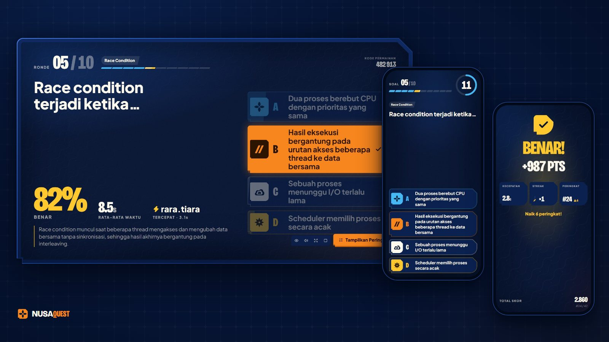

NUSAQUEST is a real-time multiplayer quiz game for university lectures. A lecturer builds a
quiz, puts the stage on the projector, and a whole lecture hall joins from their phones
with a 6-digit PIN or a QR code. Students answer against the clock, climb a live
leaderboard, and finish on a podium. The visual identity is an _Indonesian future game
show_: giant condensed numerals, a navy stage, a proprietary NUSA FRAME shape, and geometric
kawung / parang / tenun patterns. It is built to feel like a game, not an LMS form.

**Self-hosted by design.** One `docker compose up` on a Proxmox VM (or any Linux host) runs
the web app, the realtime game server and PostgreSQL. At runtime there are no external
services: no hosted database, auth or realtime provider, and students' phones talk only to
your server. Building the image needs outbound internet (Docker Hub, the Alpine package
mirror, the npm registry, and Google Fonts, which `next/font` downloads once and then serves
itself), or an HTTP proxy passed as build args
([`docs/DEPLOYMENT.md` §4](docs/DEPLOYMENT.md#4-start-the-stack)).

---

## Ringkasan (Bahasa Indonesia)

**Apa ini?** NUSAQUEST adalah kuis multiplayer real-time untuk perkuliahan di BINUS. Dosen
menyusun kuis dan menampilkan "panggung" di proyektor. Mahasiswa bergabung dari ponsel
dengan PIN 6 digit atau kode QR, berpacu dengan waktu untuk menjawab, bersaing di papan
peringkat, lalu pertandingan ditutup dengan podium. Semuanya berjalan di server kamu sendiri
(Docker di Proxmox), tanpa database, autentikasi, atau layanan realtime dari cloud pihak
ketiga.

**Coba cepat di laptop** (tanpa database dan tanpa `.env`; butuh Node.js 24, atau 22.13+,
tetapi bukan 23 atau 25):

```bash
npm ci
npm run dev              # repo di drive exFAT/FAT/USB? pakai: npm run dev:webpack
```

- Layar proyektor demo: <http://localhost:3000/host/session/demo> (41 mahasiswa simulasi
  ikut bergabung; lanjutkan ke layar berikutnya dengan Space atau →).
- Sisi mahasiswa: buka <http://localhost:3000/join> di tab atau ponsel lain, lalu masukkan
  PIN **`482913`**. Ponsel di Wi-Fi yang sama bisa ikut lewat `http://<ip-laptop>:3000/join`.
- Tanpa database ("memory mode") tidak ada login dosen, kuis disimpan di browser dosen, dan
  permainan yang sedang berjalan hilang saat server dimatikan.

**Deploy ke Proxmox dalam 6 langkah**

1. Buat VM Debian 12/13 (2 vCPU, 4 GB RAM, 32 GB SSD), lalu pasang Docker Engine beserta
   plugin Compose v2.24+ ([`docs/DEPLOYMENT.md`](docs/DEPLOYMENT.md) §1–2).
2. Siapkan folder dengan `sudo mkdir -p /opt/nusaquest && sudo chown "$USER": /opt/nusaquest`,
   lalu clone: `git clone https://github.com/SeedFlora/quizBinus.git /opt/nusaquest && cd /opt/nusaquest`. Kalau
   repositorinya privat, pakai _deploy key_ SSH yang hanya bisa membaca
   ([§3](docs/DEPLOYMENT.md#3-get-the-code-and-configure)).
3. `cp .env.example .env && chmod 600 .env`, lalu isi `POSTGRES_PASSWORD` (huruf dan angka
   saja, misalnya hasil `openssl rand -hex 24`), `ADMIN_EMAIL`, `ADMIN_PASSWORD` (minimal 8
   karakter, disarankan 12+; beri tanda kutip tunggal jika mengandung `$`) dan `APP_URL`
   (misalnya `http://10.20.30.40:3000`). Isi juga `NEXT_PUBLIC_APP_URL` dengan alamat yang
   sama agar kode QR mengarah ke server.
4. Jalankan `docker compose up -d --build`, lalu cek `curl -s http://localhost:3000/api/health`.
   Hasilnya harus memuat `"mode":"database"` dan `"db":"up"`.
5. Buka port TCP 3000 (atau 80/443 dengan HTTPS) di firewall Proxmox untuk subnet Wi-Fi
   mahasiswa ([§6](docs/DEPLOYMENT.md#6-classroom-networking); port yang dipublikasikan
   Docker tidak disaring oleh `ufw`), lalu tes `http://<ip-server>:3000/api/health` dari ponsel yang
   terhubung ke Wi-Fi kelas.
6. Buka `http://<ip-server>:3000/login`, masuk sebagai admin, segera ganti kata sandi di
   **Pengaturan**, lalu hapus `ADMIN_PASSWORD` dari `.env` dan buat akun dosen di
   **Pengaturan → Akun dosen**.

HTTP biasa cukup untuk uji coba di LAN, tetapi untuk produksi pakai HTTPS: tanpa HTTPS kata
sandi dosen melintasi Wi-Fi tanpa enkripsi dan pemindai QR di aplikasi tidak aktif. Isi
`DOMAIN` dan variabel lain di [§7](docs/DEPLOYMENT.md#7-https) terlebih dahulu, lalu
jalankan `docker compose --profile https up -d --build`. Backup, update, rollback dan
troubleshooting ada di [`docs/DEPLOYMENT.md`](docs/DEPLOYMENT.md) serta bagian
[Operations](#operations).

**Impor pertama ke GitHub, GitLab atau Gitea sendiri (sekali saja)**

Hanya untuk impor pertama dari folder serah-terima; lewati bagian ini kalau kamu
meng-clone repositori ini. Langkah lengkapnya (dalam bahasa Inggris) ada di
[Importing into your own Git host (one-time)](#importing-into-your-own-git-host-one-time).

<details>
<summary>Perintah impor pertama (folder serah-terima → GitHub, GitLab atau Gitea)</summary>

Folder serah-terima sudah menjadi repo git di branch `main`, tetapi belum punya commit.
Buat dulu repositori **kosong** di GitHub, GitLab atau Gitea (tanpa README, lisensi atau
`.gitignore`), lalu:

```bash
git add -A
git add --chmod=+x deploy/*.sh deploy/backup/*.sh   # skrip ops jadi executable (core.filemode=false di Windows)
git commit -m "chore: import NUSAQUEST 0.1.0"
git remote add origin <url-repo-kamu>
git push -u origin main
git tag -a v0.1.0 -m "NUSAQUEST 0.1.0" && git push origin v0.1.0
```

File rahasia dan hasil build (`.env`, `node_modules/`, `.next/`, `data/`, `backups/`,
`.shots/`, hasil tes) sudah otomatis diabaikan git. Jangan pernah meng-commit kata sandi
asli. CI bawaan memakai GitHub Actions; untuk GitLab atau Gitea ada catatannya di
[CI on your Git host](#ci-on-your-git-host).

</details>

---

This README is the entry point for the engineering team taking over the project:

| Document                                       | What's inside                                                                                          |
| ---------------------------------------------- | ------------------------------------------------------------------------------------------------------ |
| [`docs/DEPLOYMENT.md`](docs/DEPLOYMENT.md)     | Proxmox VM/LXC, Docker, classroom networking, HTTPS/reverse proxies, backups, updates, troubleshooting |
| [`docs/ARCHITECTURE.md`](docs/ARCHITECTURE.md) | engine, game server, realtime providers, data flow, contributor rules                                  |
| [`docs/DATABASE.md`](docs/DATABASE.md)         | PostgreSQL schema, Drizzle migrations, persistence                                                     |
| [`docs/SCALING.md`](docs/SCALING.md)           | what one instance carries; the multi-instance plan (Redis + PostgreSQL)                                |
| [`docs/DESIGN.md`](docs/DESIGN.md)             | the visual contract: tokens, typography, NUSA FRAME, motion, voice, review checklist                   |
| [`lib/ai/README.md`](lib/ai/README.md)         | quiz generation provider (mock today) and how to connect a real model                                  |
| [`AGENTS.md`](AGENTS.md)                       | auto-generated notice for coding agents (Next.js 16 docs: `node_modules/next/dist/docs/`)              |

## Contents

0. [Ringkasan (Bahasa Indonesia)](#ringkasan-bahasa-indonesia)
1. [Screenshots](#screenshots)
2. [The three experiences](#the-three-experiences)
3. [Prerequisites](#prerequisites)
4. [Quick start (zero config)](#quick-start-zero-config)
5. [Quick start (Docker)](#quick-start-docker)
6. [Memory mode and database mode](#memory-mode-and-database-mode)
7. [Environment variables](#environment-variables)
8. [Operations](#operations)
9. [Architecture](#architecture)
10. [Database and migrations](#database-and-migrations)
11. [Testing](#testing)
12. [Branding](#branding)
13. [Audio and music](#audio-and-music)
14. [Internationalization](#internationalization)
15. [Accessibility and performance](#accessibility-and-performance)
16. [Scoring](#scoring)
17. [Security model](#security-model)
18. [Scaling](#scaling)
19. [Project structure](#project-structure)
20. [Scripts](#scripts)
21. [Contributing](#contributing)
22. [Publishing this repository](#publishing-this-repository)
23. [Handover checklist](#handover-checklist)
24. [License](#license)

---

## Screenshots

Game screens come from `/preview/<screen>`, which renders each live state from a real engine
fixture; creator screens are the memory-mode demo. All names and numbers are sample data.

### Projector stage (1920×1080) and landing page

<table>
  <tr>
    <td width="50%">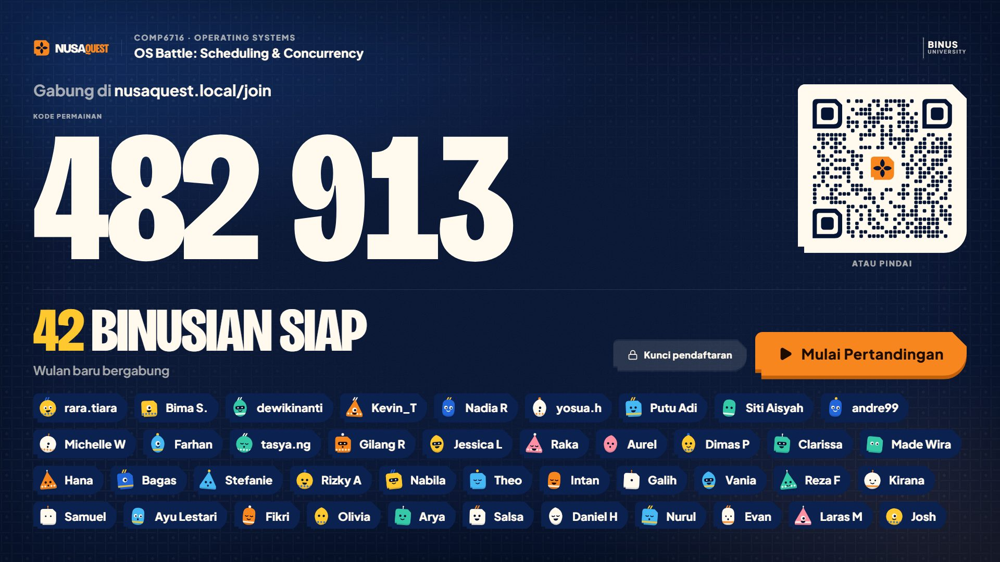<br><sub><b>Lobby</b>: the PIN, a QR code for <code>/join</code> and every Binusian who has joined; the host can lock joins or start.</sub></td>
    <td width="50%">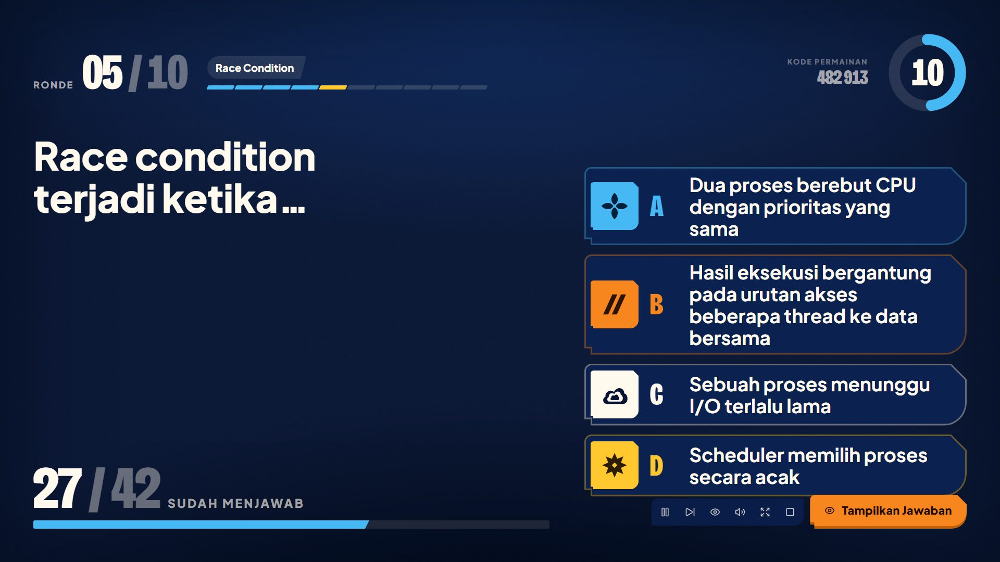<br><sub><b>Question</b>: round, timer ring and live answer count. Every answer has a colour, symbol, letter and position.</sub></td>
  </tr>
  <tr>
    <td width="50%">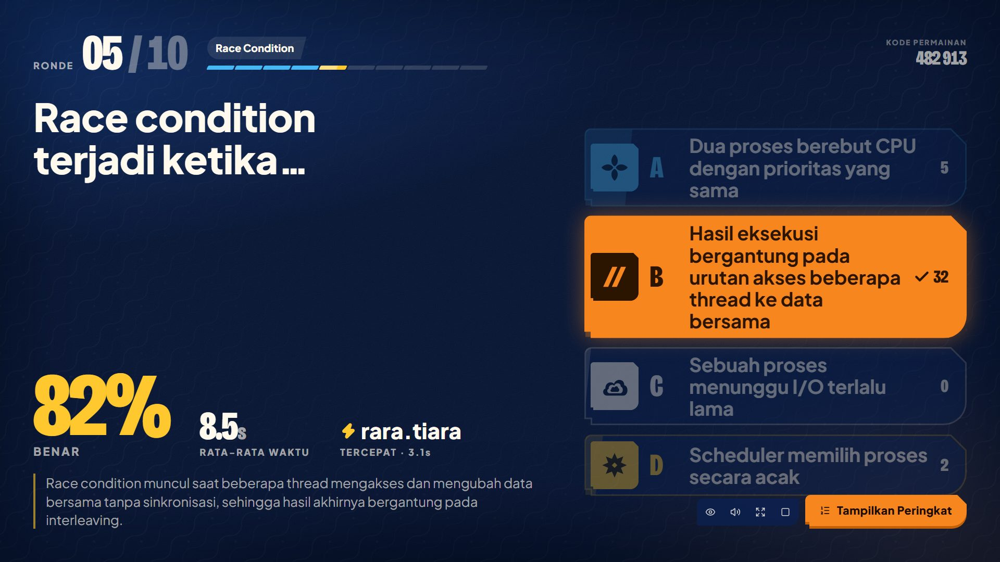<br><sub><b>Reveal</b>: the correct answer with per-option counts, the share correct, average time, the fastest player and the explanation.</sub></td>
    <td width="50%">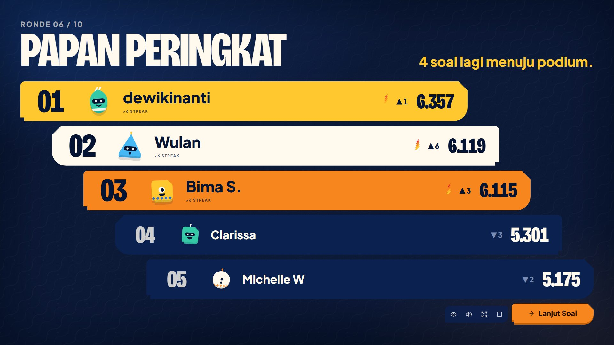<br><sub><b>Leaderboard</b>: the top five with streaks and rank movement between questions.</sub></td>
  </tr>
  <tr>
    <td width="50%">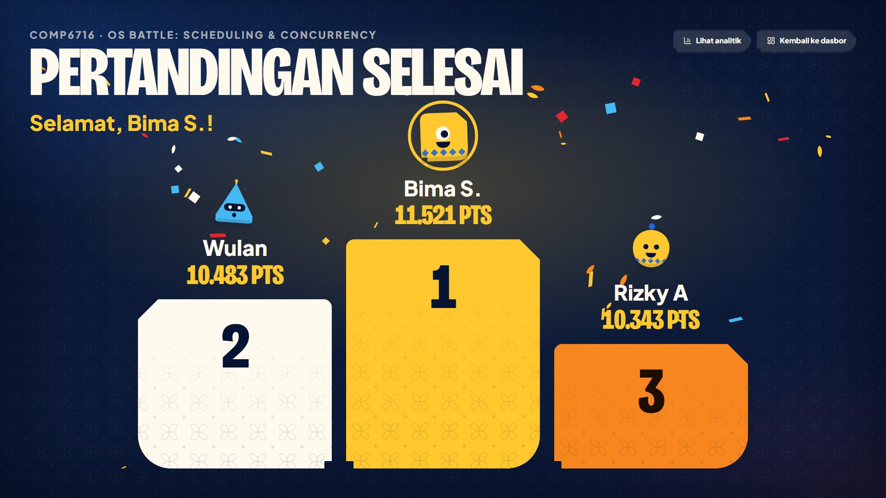<br><sub><b>Podium</b>: the staged top three, with links to the analytics and the dashboard.</sub></td>
    <td width="50%">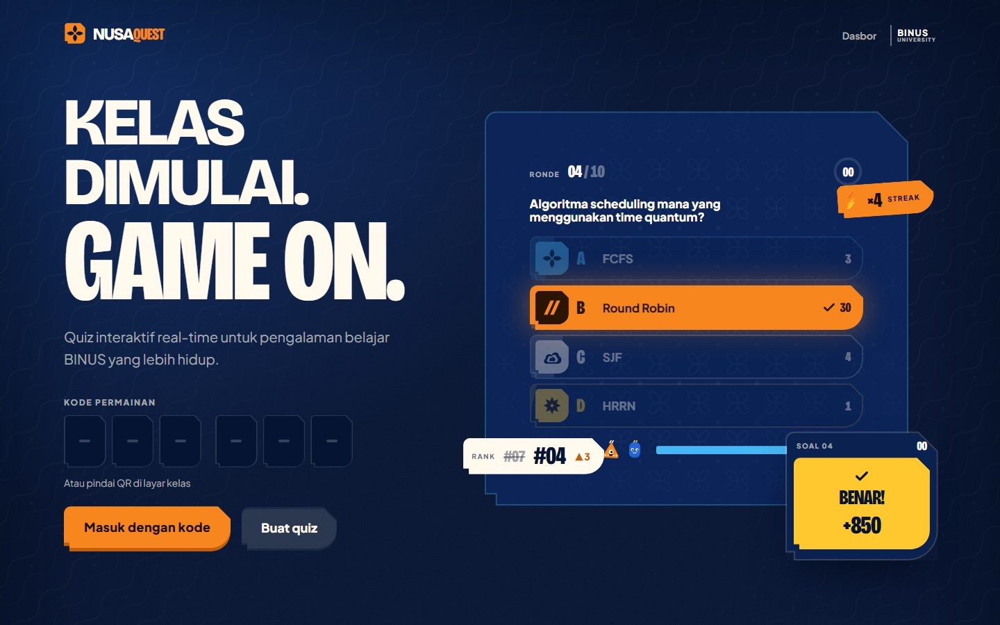<br><sub><b>Landing page</b> (<code>/</code>, 1440×900): join with a game PIN or create a quiz.</sub></td>
  </tr>
</table>

### Player phone (390 px wide)

<table>
  <tr>
    <td align="center"><br><sub><b>Join</b>: PIN or QR code</sub></td>
    <td align="center">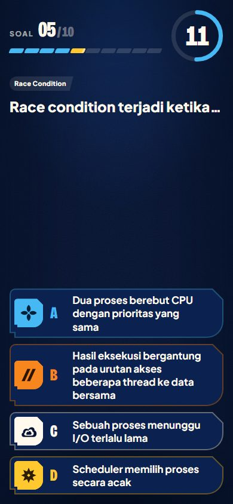<br><sub><b>Question</b>: the phone as a controller</sub></td>
    <td align="center">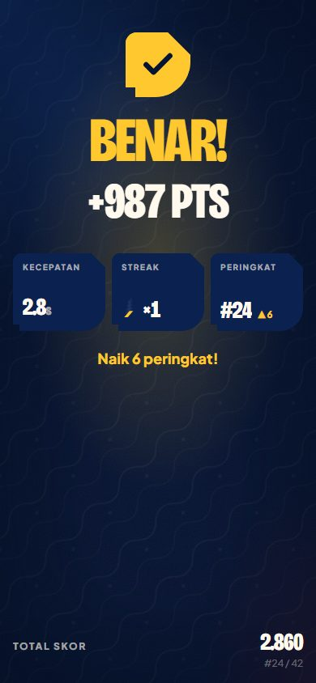<br><sub><b>Result</b>: points, streak, rank movement</sub></td>
    <td align="center">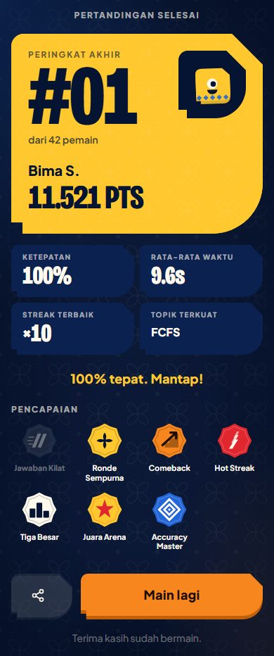<br><sub><b>Final summary</b>: rank, stats, achievements</sub></td>
  </tr>
</table>

### Creator app for lecturers (1440×900)

<table>
  <tr>
    <td width="33%">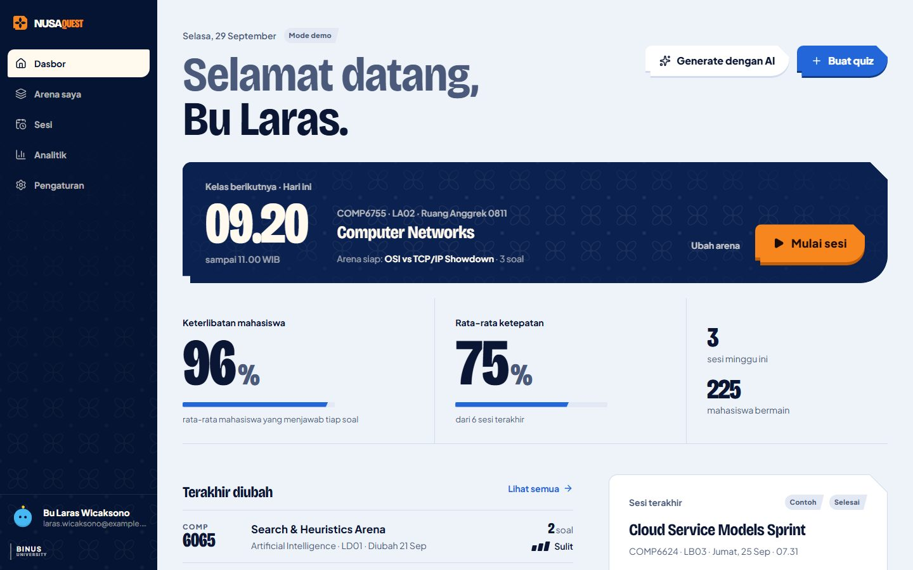<br><sub><b>Dashboard</b>: the next class, engagement and accuracy at a glance.</sub></td>
    <td width="33%">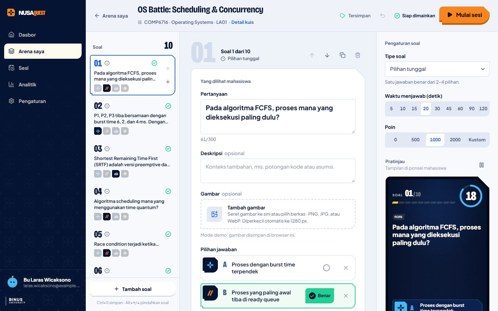<br><sub><b>Editor</b>: question list, question form, settings and a live phone preview.</sub></td>
    <td width="33%">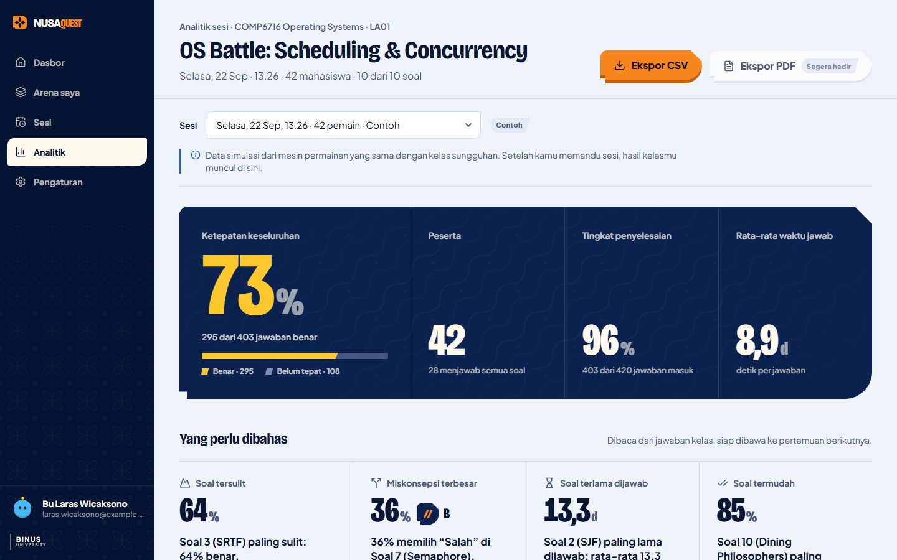<br><sub><b>Analytics</b>: per-session results, what to discuss next, CSV export.</sub></td>
  </tr>
</table>

<details>
<summary>Retaking the screenshots</summary>

`hero.jpg` is a composite of the reveal, question and result screens made outside the
repository. The other files come from `scripts/shot.mjs`, run against a memory-mode dev
server on port 3100 (in Git Bash on Windows, prefix each command with `MSYS_NO_PATHCONV=1`,
or paths such as `/join` are rewritten into Windows paths):

```bash
npm run dev:webpack -- -p 3100             # or `npm run dev -- -p 3100` off exFAT/FAT drives
npm run shot -- / docs/screenshots/landing.jpg 1440x900 --wait=10500 --hide-dev
npm run shot -- /join docs/screenshots/player-join.jpg 390x844 --hide-dev
npm run shot -- /preview/player-question docs/screenshots/player-question.jpg 390x844 --wait=1500 --hide-dev
npm run shot -- /preview/player-result-correct docs/screenshots/player-result.jpg 390x844 --wait=1500 --hide-dev
npm run shot -- "/preview/player-final?as=winner" docs/screenshots/player-final.jpg 390x844 --full --hide-dev
npm run shot -- /preview/host-lobby docs/screenshots/host-lobby.jpg 1920x1080 --wait=3000 --hide-dev --host=nusaquest.local
npm run shot -- /preview/host-question docs/screenshots/host-question.jpg 1920x1080 --hide-dev
npm run shot -- /preview/host-reveal docs/screenshots/host-reveal.jpg 1920x1080 --hide-dev
npm run shot -- /preview/host-leaderboard docs/screenshots/host-leaderboard.jpg 1920x1080 --wait=3500 --hide-dev
npm run shot -- /preview/host-podium docs/screenshots/host-podium.jpg 1920x1080 --wait=7500 --hide-dev
npm run shot -- /dashboard docs/screenshots/creator-dashboard.jpg 1440x900 --hide-dev
npm run shot -- /quizzes/os-battle/edit docs/screenshots/creator-editor.jpg 1440x900 --hide-dev
npm run shot -- /quizzes/os-battle/analytics docs/screenshots/creator-analytics.jpg 1440x900 --hide-dev
```

`--host=nusaquest.local` makes the lobby print `nusaquest.local/join` instead of
`localhost:3100/join`. Confetti and the landing-page loop are animated, so check timed shots
by eye.

</details>

---

## The three experiences

Three products share DNA but not layouts (full information architecture in
[`docs/DESIGN.md` §1](docs/DESIGN.md#1-information-architecture)).

### A. Player: the phone is a game controller

`/join?room=XXXXXX` → `/join/profile` (nickname + geometric avatar) → `/room/[code]/lobby`
→ `/play/[sessionId]`

One client controller swaps views as the authoritative phase changes: question, waiting
("Jawaban terkunci"), result ("Benar!" / "Belum tepat", points, rank movement), and the
final personal summary. Answers are always identified by **colour + symbol + letter +
position** (A kawung, B parang, C mega mendung, D bintang). A refresh or a dropped mobile
connection resumes exactly where the player was and can never submit twice.

### B. Host: the projector stage (16:9, adapts to 4:3)

`/host/session/[id]/lobby` → `/host/session/[id]` → `/host/session/[id]/podium`

The lobby shows the PIN, a scannable QR code, and players popping in (when the projector
page runs on `localhost`, it also lists the laptop's LAN addresses so phones can join). The
stage then runs intro → question → reveal → leaderboard for each question, followed by a
staged podium. Everything is sized to be read from the back row. Host controls cover
pause, skip, lock joins, hide the leaderboard, kick a player, and end the session. The
stage also works with a keyboard or presenter clicker: Space / Enter / → / PageDown
advance, **P** pauses, **F** toggles fullscreen and **M** mutes.

### C. Creator: the calm authoring app for lecturers

`/login`, `/dashboard`, `/quizzes`, `/quizzes/new`, `/quizzes/[id]/edit`,
`/quizzes/[id]/analytics`, `/analytics` (opens the latest class report), `/sessions`,
`/settings`

A light "desk" theme with a three-pane editor. Playable question types: single choice,
multiple choice, true/false, short answer, poll, ordering, and numeric (with tolerance).
Image hotspot, word cloud and matching are modelled but not yet playable. Analytics show
per-question difficulty, distributions, learning-outcome performance and CSV export after a
session. Only the **classic** game mode is enabled in this release; `team`, `mastery` and
`practice` are typed but hidden in the UI.

- **Accounts.** In database mode lecturers sign in with email + password. Admins manage
  lecturer accounts in _Settings → Lecturer accounts_ (temporary passwords shown once) or
  with `deploy/users.sh` (see [Operations](#operations)).
- **Generate with AI** (`/quizzes/new?mode=ai`) runs through the `QuizGenerationProvider`
  interface. This release ships a deterministic **mock** that uses a verified bilingual
  question bank, makes no network calls, and is labelled as a mock in the UI. Connecting a
  real model (server-side only, keys never in the browser) is described in
  [`lib/ai/README.md`](lib/ai/README.md). Its example calls a cloud AI gateway; to stay
  fully self-hosted, point the route handler at a model served inside your network instead
  (for example an OpenAI-compatible endpoint from Ollama or vLLM on Proxmox). A cloud AI API
  would be the project's only external dependency and needs explicit approval. Lecturers
  must review every generated draft.
- **Question images** are resized in the browser, then uploaded to the server
  (`POST /api/media`, stored on the `UPLOAD_DIR` volume) in database mode, or kept inline
  as data URLs in memory mode.

---

## Prerequisites

| For                           | You need                                                                                                                                    |
| ----------------------------- | ------------------------------------------------------------------------------------------------------------------------------------------- |
| Development                   | **Node.js 24 LTS** (22.13+ also works; not 23 or 25, the test tooling rejects them; CI and the Docker image use 24), npm, Git               |
| Docker / the server           | Docker Engine with the **Compose plugin v2.24+** (or Docker Desktop), Git, outbound internet (or a proxy) while building, see DEPLOYMENT §4 |
| Windows                       | **Git Bash** or **WSL** for the bash snippets in this README (`cp`, `VAR=value command`, `bash deploy/*.sh`); PowerShell syntax differs     |
| End-to-end tests, screenshots | `npx playwright install chromium` once (`scripts/shot.mjs` falls back to an installed Chrome or Edge)                                       |

---

## Quick start (zero config)

No database, no accounts, no `.env`, and still **real multi-device play on your LAN**:

```bash
npm ci               # installs exactly what package-lock.json lists (same as CI and the Dockerfile)
npm run dev          # prints Local http://localhost:3000 and Network http://<laptop-ip>:3000
```

| Try            | Open                                           | What happens                                                                                                                                                                                                                                        |
| -------------- | ---------------------------------------------- | --------------------------------------------------------------------------------------------------------------------------------------------------------------------------------------------------------------------------------------------------- |
| Projector demo | <http://localhost:3000/host/session/demo>      | starts the shared **server** demo: 41 simulated students trickle in; the lobby shows the LAN address so real phones can join too. Drive the stage with Space / →. With a database configured, sign in first (only lecturers can start and drive it) |
| Player demo    | <http://localhost:3000/join>, PIN **`482913`** | joins the server demo if a projector started it; otherwise a solo demo runs entirely in the browser (works offline)                                                                                                                                 |
| Real game      | <http://localhost:3000/dashboard>              | the creator with seed quizzes (e.g. _OS Battle: Scheduling & Concurrency_); start a session and join from phones via `http://<laptop-ip>:3000/join`                                                                                                 |

Phones must be on the same network as the laptop and allowed through its firewall (on
Windows: allow Node.js on _Private_ networks). Campus Wi-Fi often isolates wireless clients
from each other; a phone hotspot or travel router works for small groups. For a real
deployment use a server (next section).

**exFAT / FAT32 drives (USB sticks, some external disks):** these file systems have no
symlinks or junctions, which Turbopack's dev server relies on. If `npm run dev` fails or
hangs there, use `npm run dev:webpack` (the same dev server on webpack; slower first
compiles, otherwise identical). Docker builds run on Linux inside the container and are
not affected.

On a fresh clone, `npm run typecheck` needs the generated route types (`PageProps`,
`LayoutProps`) that `next dev` / `next build` write to `.next/types`. Run
`npx next typegen` once if you type-check before starting the dev server.

**Development with PostgreSQL** (database mode on your machine). Start the bundled database:

```bash
cp .env.example .env               # then set POSTGRES_PASSWORD (letters+digits) in .env
npm run db:up                      # compose PostgreSQL on 127.0.0.1:5432 only
```

Create `.env.local` next to it:

```ini
DATABASE_URL=postgres://nusaquest:<POSTGRES_PASSWORD>@localhost:5432/nusaquest
ADMIN_EMAIL=you@example.ac.id
ADMIN_PASSWORD=<at least 8 characters>
```

Then `npm run dev` applies the migrations, creates the admin and imports 5 demo quizzes.
`next dev` reads both `.env` and `.env.local`; the drizzle-kit commands (`npm run db:migrate`,
`npm run db:studio`) read only `.env`, so for those export `DATABASE_URL` in the shell or
put it in `.env` as well.

---

## Quick start (Docker)

On the server (a Debian VM on Proxmox is the reference setup, see
[`docs/DEPLOYMENT.md`](docs/DEPLOYMENT.md)):

```bash
sudo mkdir -p /opt/nusaquest && sudo chown "$USER": /opt/nusaquest
git clone https://github.com/SeedFlora/quizBinus.git /opt/nusaquest && cd /opt/nusaquest
cp .env.example .env && chmod 600 .env
```

For a **private** repository, give the server read-only access with an SSH deploy key or a
read-only access token, never your personal credentials
([`docs/DEPLOYMENT.md` §3](docs/DEPLOYMENT.md#3-get-the-code-and-configure)). Then edit `.env`:

```ini
POSTGRES_PASSWORD=<output of: openssl rand -hex 24>
ADMIN_EMAIL=it-admin@example.ac.id
ADMIN_PASSWORD=<12+ characters; wrap the value in single quotes if it contains $>
ADMIN_NAME=NUSAQUEST Admin
APP_URL=http://<server-ip-or-name>:3000
NEXT_PUBLIC_APP_URL=http://<server-ip-or-name>:3000
```

Plain HTTP is fine for a LAN pilot; use HTTPS (below) in production. Over plain HTTP,
lecturer passwords cross the Wi-Fi in clear text and the in-app QR scanner is disabled.

```bash
docker compose up -d --build       # first build ~3–6 min (Docker Hub, Alpine, npm registry, Google Fonts)
docker compose ps                  # app + db "healthy"
curl -s http://localhost:3000/api/health
# {"ok":true,"mode":"database","db":"up","sessions":0,"subscribers":0,"version":"0.1.0"}
```

Confirm `"mode":"database"` and `"db":"up"` after every deploy (see
[Environment variables](#environment-variables) for why). Behind a campus HTTP proxy, pass
it to the build as `HTTP_PROXY` / `HTTPS_PROXY` build args
([`docs/DEPLOYMENT.md` §4](docs/DEPLOYMENT.md#4-start-the-stack)).

Then let the phones in: allow TCP 3000 (or 80/443 behind a proxy) from the student Wi-Fi
subnets in the Proxmox firewall
([`docs/DEPLOYMENT.md` §6](docs/DEPLOYMENT.md#6-classroom-networking); Docker-published
ports bypass `ufw`), and open `http://<server>:3000/api/health` from a phone on the
classroom Wi-Fi. If it loads, the game will work. Finally sign in at
`http://<server>:3000/login` and continue with [Operations](#operations).

Optional profiles:

- **HTTPS with Caddy** (automatic certificates): the `caddy` service exits unless `DOMAIN`
  is set. First set `DOMAIN`, `APP_PORT=127.0.0.1:3000`, `TRUST_PROXY=true` and `https://`
  values for `APP_URL` / `NEXT_PUBLIC_APP_URL` in `.env`
  ([`docs/DEPLOYMENT.md` §7](docs/DEPLOYMENT.md#7-https)), then run
  `docker compose --profile https up -d --build`.
- **Scheduled backups** (`pg_dump` + uploads archive): `mkdir -p backups && chmod 700 backups`
  first, then `docker compose --profile backup up -d`
  ([`docs/DEPLOYMENT.md` §8](docs/DEPLOYMENT.md#8-backups-and-restore)).

The [`Dockerfile`](Dockerfile) is a multi-stage `node:24-alpine` build: `npm ci`, `next build`
with `output: "standalone"`, then a minimal runtime (non-root `node` user, port 3000,
`HEALTHCHECK` on `/api/health`) that also carries the SQL migrations from `drizzle/`.
Migrations run automatically at every start.

---

## Memory mode and database mode

The same build runs in two modes, chosen at runtime by `DATABASE_URL`:

|                                 | Memory mode (no `DATABASE_URL`)               | Database mode (`DATABASE_URL` set)         |
| ------------------------------- | --------------------------------------------- | ------------------------------------------ |
| Game server (multi-device, SSE) | ✅ in the Next.js process                     | ✅ same, plus write-behind to PostgreSQL   |
| Survives a restart              | ❌ live games are lost                        | ✅ running sessions are restored           |
| Lecturer sign-in                | ❌ demo lecturer, no sign-in                  | ✅ email + password; first admin from env  |
| Quizzes stored in               | the lecturer's browser (localStorage + seeds) | PostgreSQL                                 |
| Question images                 | inline data URLs                              | files on the `UPLOAD_DIR` volume           |
| Analytics                       | sessions in this browser + a simulated demo   | PostgreSQL (full engine state per session) |

`npm run dev` without a `DATABASE_URL` gives memory mode; `docker compose up` gives database
mode. The **local** transport (BroadcastChannel, a browser tab as authority) remains for the
offline solo demo and for builds with `NEXT_PUBLIC_REALTIME_MODE=local`.

---

## Environment variables

The app, build and Compose variables are documented in [`.env.example`](.env.example) and
[`docs/DEPLOYMENT.md` §11](docs/DEPLOYMENT.md#11-environment-reference); the tooling
variables (tests, scripts) are listed only in the last table below. All are optional for
`npm run dev`. Server variables are validated with Zod in `lib/env.server.ts`; browser
variables in `lib/env.public.ts`.

**App (server and browser)**

| Variable                         | Scope                   | Default                                          | Purpose                                                                                                                     |
| -------------------------------- | ----------------------- | ------------------------------------------------ | --------------------------------------------------------------------------------------------------------------------------- |
| `DATABASE_URL`                   | server, **secret**      | empty = memory mode                              | PostgreSQL connection (compose builds it from `POSTGRES_*`)                                                                 |
| `ADMIN_EMAIL` / `ADMIN_PASSWORD` | server, **secret**      | empty                                            | first admin, created only while no user exists; password ≥ 8 characters                                                     |
| `ADMIN_NAME`                     | server                  | `Administrator`                                  | that admin's display name                                                                                                   |
| `APP_URL`                        | server                  | `NEXT_PUBLIC_APP_URL`                            | canonical public origin (join address, CSRF allow-list)                                                                     |
| `SESSION_COOKIE_SECURE`          | server                  | `auto`                                           | `auto` \| `true` \| `false` for the `nq_session` cookie                                                                     |
| `TRUST_PROXY`                    | server                  | `false`                                          | `true` behind a proxy that overwrites `X-Forwarded-For`. Only `true`/`1`/`false`/`0` are accepted                           |
| `UPLOAD_DIR`                     | server                  | `./data/uploads` (`/app/data/uploads` in Docker) | uploaded question images                                                                                                    |
| `TZ`                             | server, backup          | `Asia/Jakarta`                                   | logs, backup timestamps, server-rendered dates                                                                              |
| `APP_VERSION`                    | build + server          | `package.json` version                           | reported by `GET /api/health`; pass it on the same command as the build (see [Operations](#operations)) or set it in `.env` |
| `NEXT_PUBLIC_APP_URL`            | browser, **build time** | page origin                                      | origin encoded in lobby QR codes                                                                                            |
| `NEXT_PUBLIC_REALTIME_MODE`      | browser, **build time** | `server`                                         | `server` (multi-device) \| `local` (single-browser demo)                                                                    |
| `NEXT_PUBLIC_BINUS_LOGO_SRC`     | browser, **build time** | empty                                            | official logo path/URL (see [Branding](#branding))                                                                          |

**Docker Compose**

| Variable                                                      | Used by           | Default                      | Purpose                                                                 |
| ------------------------------------------------------------- | ----------------- | ---------------------------- | ----------------------------------------------------------------------- |
| `POSTGRES_USER` / `POSTGRES_DB`                               | `db`              | `nusaquest`                  | role and database of the bundled PostgreSQL                             |
| `POSTGRES_PASSWORD`                                           | `db`, **secret**  | required                     | letters and digits only (it is embedded in a URL)                       |
| `APP_PORT`                                                    | `app`             | `3000`                       | host port; `127.0.0.1:3000` when a proxy on the same host is the way in |
| `DOMAIN`                                                      | `caddy` (`https`) | empty                        | site address for Caddy; the service exits while it is unset             |
| `COMPOSE_PROFILES`                                            | compose           | empty                        | enable profiles permanently, e.g. `https,backup`                        |
| `BACKUP_INTERVAL_SECONDS` / `BACKUP_KEEP_DAYS` / `BACKUP_DIR` | `backup`          | `86400` / `14` / `./backups` | backup loop                                                             |
| `APP_IMAGE_TAG`                                               | `app`             | `local`                      | tag of the built or pulled app image                                    |
| `DB_PORT`                                                     | dev overlay       | `5432`                       | loopback port for `npm run db:up`                                       |

**Tooling**

| Variable                                 | Used by            | Default                 | Purpose                                                                           |
| ---------------------------------------- | ------------------ | ----------------------- | --------------------------------------------------------------------------------- |
| `TEST_DATABASE_URL`                      | Vitest             | empty (tests skip)      | PostgreSQL integration tests; the role needs `CREATEDB` (see [Testing](#testing)) |
| `E2E_BASE_URL`                           | Playwright         | `http://localhost:3100` | run the end-to-end suite against an existing server                               |
| `E2E_ADMIN_EMAIL` / `E2E_ADMIN_PASSWORD` | Playwright         | empty                   | sign-in for the lecturer specs in database mode (they skip without it)            |
| `BASE_URL`                               | `scripts/shot.mjs` | `http://localhost:3100` | server for relative screenshot paths                                              |
| `NQ_PASSWORD`                            | `deploy/users.sh`  | empty (prompt)          | non-interactive password for `add` / `reset-password`                             |

Things that bite:

- **A malformed value is logged and ignored, never a crash.** For `DATABASE_URL` that means
  the server silently runs in **memory mode** and saves nothing, while sign-in redirects still
  behave as if a database were configured. After every deploy, check that `/api/health`
  reports `"mode":"database","db":"up"`. `TRUST_PROXY=TRUE` or `yes` is ignored the same way.
- **`NEXT_PUBLIC_*` values are inlined into the browser bundle** by `next build`: change one
  → rebuild (`docker compose up -d --build`). Never put a secret in one.
- **`$` in `.env`.** Docker Compose expands `$` in unquoted and double-quoted values, which
  silently changes a password such as `pa$$word`. Wrap such values in single quotes
  (`ADMIN_PASSWORD='pa$$word'`). The suggested generators (`openssl rand -hex 24`,
  `openssl rand -base64 18`) never produce `$`.

---

## Operations

Day-to-day tasks on the server, run from `/opt/nusaquest`. The full runbook is
[`docs/DEPLOYMENT.md`](docs/DEPLOYMENT.md): §5 accounts, §8 backups, §9 updates,
§10 monitoring, §12 troubleshooting.

**After the first start**

1. Sign in at `/login` with `ADMIN_EMAIL` / `ADMIN_PASSWORD`. The admin already owns the
   five demo quizzes, so a full game can be tried immediately.
2. Change that password in _Settings_ (_Pengaturan → Kata sandi_), then delete
   `ADMIN_PASSWORD` from `.env`. It is read only while the users table is empty; changing it
   later changes nothing.
3. Create lecturer accounts in _Settings → Lecturer accounts_ (_Pengaturan → Akun dosen_).
   The temporary password is shown **once**; hand it over in person.

**Accounts from the server shell.** There is no email or self-service password reset: an
admin resets a forgotten password in _Settings_, or with `deploy/users.sh`, which hashes
inside the app container and refuses to disable or demote the last active admin:

```bash
bash deploy/users.sh list
bash deploy/users.sh add dosen1@example.ac.id "Dr. Rina Wijaya"          # lecturer, prompts for a password
bash deploy/users.sh add it-ops@example.ac.id "IT Ops" admin             # another admin
bash deploy/users.sh reset-password dosen1@example.ac.id                 # also signs them out everywhere
bash deploy/users.sh disable dosen1@example.ac.id                        # or: enable
bash deploy/users.sh role dosen1@example.ac.id admin
```

**Backups** (database + uploaded images; `.env` belongs in the team's password manager):

```bash
mkdir -p backups && chmod 700 backups        # create it yourself; a folder Docker creates is owned by root
docker compose --profile backup up -d        # first backup now, then every 24 h, 14 days kept
bash deploy/backup/backup.sh                 # one-off backup, e.g. before an update
bash deploy/backup/restore.sh backups/nusaquest-<ts>.dump backups/uploads-<ts>.tar.gz
```

Copy `backups/` off the VM (NAS, Proxmox Backup Server): a backup on the same disk is not a
backup. Rehearse a restore once per semester.

**Updates** (outside lecture hours; the restart takes ~5–15 s and live games are restored):

```bash
bash deploy/backup/backup.sh                                             # safety net first
git pull
APP_VERSION=$(git rev-parse --short HEAD) docker compose up -d --build   # one command: build + run with the version
curl -s http://localhost:3000/api/health                                 # "mode":"database", "db":"up", new "version"
docker image prune -f
```

`APP_VERSION` is optional. Pass it on the same command as the build: a separate
`docker compose up -d` without it recreates the app and reports the `package.json` version
again. Put `APP_VERSION=` in `.env` instead if you want it to stick.

**Rollback:** `git checkout <previous tag> && docker compose up -d --build` (tag every
release you deploy; run `git checkout main` before the next `git pull`). Migrations are
forward-only: if the newer release added one the old code cannot handle, restore the backup
taken before the update.

**Logs and health.** `docker compose ps` shows the health checks. `docker compose logs -f app`
shows errors, and on the very first boot only `created admin account …` and
`imported 5 demo quizzes …`; successful migrations log nothing. Watch for
`[nusaquest] database startup failed`. Point an uptime monitor (e.g. Uptime Kuma) at
`/api/health` with the keyword `"ok":true`.

---

## Architecture

```
                 ┌──────────────────── Next.js 16 · App Router (one Node process) ───────────────────┐
 lecturer  ────▶ │ (creator)  dashboard · quizzes · editor · analytics · settings  ── /api/quizzes   │
 laptop          │ (host)     /host/session/[id]  projector stage + controls                         │
 students  ────▶ │ (player)   /join → lobby → /play/[sessionId]                                      │
 phones          │ app/api/*  thin route handlers → lib/server (game API, SSE, auth, media)          │
                 └───────────────┬────────────────────────────────────────────────┬──────────────────┘
                                 │ every screen talks to one interface:           │ write-behind
                                 │ RealtimeGameProvider (lib/realtime/types.ts)   ▼
             ┌───────────────────┴───────────────┐                          PostgreSQL (Drizzle)
   ServerRealtimeProvider (default)       LocalRealtimeProvider             accounts · quizzes ·
   HTTP commands + SSE stream             BroadcastChannel, tab = authority sessions · answers ·
   ServerGameRuntime → GameAuthority      offline solo demo (PIN 482913)    reports
                                 │
                 GameEngine (lib/game/engine.ts): deterministic, serializable state machine
                 lobby → intro → question → reveal → leaderboard → … → finished | ended
                 snapshotFor(now, playerId?) is the only way state leaves the engine,
                 and it never contains correctness data for an open question.
```

- **One source of truth.** `GameEngine` owns all game rules; time is passed in, so the
  engine is pure and unit-tested. Scoring lives in `lib/game/scoring.ts`.
- **The server is the authority.** `ServerGameRuntime` (`lib/server/game-runtime.ts`) keeps
  one `GameAuthority` per live session in memory (timers, player tokens, fan-out).
  Commands are JSON POSTs; live events stream as Server-Sent Events read with `fetch`
  (the player token travels in the POST body, never in a URL). Every (re)connection starts
  with a full snapshot, so reconnecting phones recover automatically.
- **The same authority class runs in a browser tab** for the offline demo, so both modes
  share one tested implementation.
- **Persistence is write-behind** through the `SessionPersistence` interface: PostgreSQL in
  database mode, a no-op in memory mode. Unfinished sessions are restored on boot.
- **Startup** (`instrumentation.ts` → `lib/server/bootstrap.ts`): migrations → first admin
  (+ 5 demo quizzes) → session restore. Never crashes the server if the database is down;
  it retries on a later request.

Details: [`docs/ARCHITECTURE.md`](docs/ARCHITECTURE.md).

**Stack:** Next.js 16.3 (App Router, Turbopack, `output: "standalone"`) · React 19 ·
TypeScript (strict) · Tailwind CSS v4 (CSS-first tokens) · Motion (`motion/react`) · Zod 4 ·
PostgreSQL 17 via Drizzle ORM + `pg` · Vitest + Testing Library · Playwright · Docker.

> **Next.js 16 is not the Next.js you remember.** `middleware.ts` is now `proxy.ts`, route
> `params` are async (`await params`), and `PageProps<'/route'>` / `LayoutProps<'/route'>` /
> `RouteContext<'/route'>` are global types. The bundled docs in `node_modules/next/dist/docs/`
> match the installed version exactly. Read them before changing framework code (see
> `AGENTS.md`).

---

## Database and migrations

Schema, migrations and persistence are described in [`docs/DATABASE.md`](docs/DATABASE.md).
In short:

- `lib/db/schema.ts` (Drizzle, `pg-core`) is the single source of truth: `users`,
  `auth_sessions`, `quizzes`, `questions`, `answers`, `game_sessions` (with the full
  `engine_state`), `players`, `player_answers`, `leaderboard_snapshots`, `session_events`,
  `media`.
- Change the schema → `npm run db:generate` → review and **commit** the new SQL in `drizzle/`.
  CI fails if the schema and the committed migrations disagree.
- The server applies pending migrations **at every start** (`lib/db/migrate.ts`, guarded by a
  PostgreSQL advisory lock). There is no separate deploy step; `npm run db:migrate`
  (drizzle-kit) exists for manual operations.
- `npm run db:migrate` and `npm run db:studio` (Drizzle Studio) read `DATABASE_URL` from the
  shell or from `.env`, **not** from `.env.local`.
- Migrations are forward-only. Never edit a migration that has been applied anywhere.
- Backups and restore: [Operations](#operations) and
  [`docs/DEPLOYMENT.md` §8](docs/DEPLOYMENT.md#8-backups-and-restore).

---

## Testing

| Layer                                                                     | Tool                            | Location                                                     | Command            |
| ------------------------------------------------------------------------- | ------------------------------- | ------------------------------------------------------------ | ------------------ |
| Unit (engine, scoring, evaluation, authority, auth, validation, security) | Vitest, Node env                | `tests/unit/**/*.test.ts`                                    | `npm test`         |
| PostgreSQL integration (repositories, session persistence)                | Vitest + a real PostgreSQL      | `tests/unit/**` (skip unless `TEST_DATABASE_URL` is set)     | `npm test`         |
| Components and hooks                                                      | Vitest + Testing Library, jsdom | `tests/components/**/*.test.tsx`, `tests/unit/**/*.test.tsx` | `npm test`         |
| End-to-end (join, play, host, reconnect, creator)                         | Playwright                      | `tests/e2e/`                                                 | `npm run test:e2e` |

```bash
npm test                                   # all Vitest projects once
npm run test:watch                         # watch mode
npx vitest run --project unit              # one project
npm run check                              # typecheck + lint + all Vitest tests (pre-push)

# PostgreSQL integration tests: a THROWAWAY server. Each test file creates and drops its own
# database, so the role needs CREATEDB (the superuser below has it).
docker run -d --name nq-test-pg -e POSTGRES_USER=nq -e POSTGRES_PASSWORD=nq \
  -e POSTGRES_DB=nusaquest_test -p 55432:5432 postgres:17-alpine
TEST_DATABASE_URL=postgres://nq:nq@localhost:55432/nusaquest_test npm test

npx playwright install chromium            # once per machine
npm run test:e2e                           # reuses the server on :3100, or starts `next dev -p 3100`
```

**End-to-end target.** By default Playwright uses `http://localhost:3100`: it reuses whatever
already answers there, and only when nothing does it starts `npx next dev -p 3100`
(Turbopack). Next 16 allows one `next dev` per project directory, so reuse is the normal case.
On exFAT/FAT drives start `npm run dev:webpack -- -p 3100` yourself first. That server runs in
memory mode unless `.env` or `.env.local` sets `DATABASE_URL`.

To test another server, set `E2E_BASE_URL`, e.g. `E2E_BASE_URL=http://localhost:3000` for the
compose stack. In database mode the lecturer and host specs sign in with
`E2E_ADMIN_EMAIL` / `E2E_ADMIN_PASSWORD` (the bootstrap admin) and skip themselves without
them; `creator-flow.spec.ts` covers memory mode only.

**CI** ([`.github/workflows/ci.yml`](.github/workflows/ci.yml), GitHub Actions, Node 24):

1. **Typecheck, lint, test** (`verify`): `npm ci` → `next typegen` → typecheck → lint →
   migrations-in-sync check → Vitest with a `postgres:17-alpine` service (`TEST_DATABASE_URL` set)
2. **Production build** (`build`): `next build`
3. **Docker image + compose smoke test** (`docker`): builds the image (not pushed), checks its
   contents, then starts the full compose stack and asserts `/api/health` reports `"db":"up"`
   and the admin was bootstrapped
4. **End-to-end (Playwright)** (`e2e`, manual: _Actions → CI → Run workflow_): the standalone
   production server on port 3200, memory mode

Other Git hosts: see [CI on your Git host](#ci-on-your-git-host).

**Visual review:** `npm run shot -- <path> .shots/<name>.png <W>x<H>` captures a page with
Playwright. Flags: `--wait=ms`, `--full`, `--reduced-motion`, `--hide-dev` (hides the Next
dev indicator), `--quality=n` (JPEG output, default 82) and `--host=name` (serve the page under
another hostname). `/preview` lists every live player and host state rendered from a real
engine fixture, with variants such as `?stress=1` (worst-case 20-character nicknames),
`?t=4` (urgent timer) or `?as=winner`. The registry is `components/dev/preview/screens.ts`.
Check every screen against the
[`docs/DESIGN.md` §11 checklist](docs/DESIGN.md#11-review-checklist-every-screen).

---

## Branding

> **The colours in this repository are PROJECT TOKENS inspired by BINUS University's public
> visual language (institutional blue + orange/yellow energy). They are NOT the official
> BINUS Graphic Standard.** No official BINUS asset is bundled.

| What                                 | Where                                          | How to replace                                                                                                                                                                                                                                  |
| ------------------------------------ | ---------------------------------------------- | ----------------------------------------------------------------------------------------------------------------------------------------------------------------------------------------------------------------------------------------------- |
| Colour tokens                        | `app/styles/tokens.css`                        | Change primitive values only (e.g. `--binus-blue-500`). Every component reads semantic tokens exposed through `app/globals.css` `@theme`, so nothing else changes. The Tailwind default palette is cleared on purpose.                          |
| BINUS logo                           | `public/brand/` + `NEXT_PUBLIC_BINUS_LOGO_SRC` | Create `public/brand/` (git does not keep empty folders), add the official file (SVG preferred), set `NEXT_PUBLIC_BINUS_LOGO_SRC=/brand/<file>.svg`, rebuild. Empty means a neutral typographic placeholder (`components/brand/BinusLogo.tsx`). |
| Product name, tagline, support email | `lib/brand.ts`                                 | `NUSAQUEST` is a working title; the wordmark, metadata and PWA manifest read from here.                                                                                                                                                         |
| Fonts                                | `app/layout.tsx`                               | Bricolage Grotesque (numerals/display) + Plus Jakarta Sans (UI) via `next/font` (self-hosted at build time).                                                                                                                                    |
| App icon / PWA icons                 | `app/icon.svg`, `public/icons/`                | `scripts/generate-icons.mjs` regenerates the PNGs.                                                                                                                                                                                              |
| Theme colour                         | `lib/brand.ts` → `themeColor`                  | also used by the manifest and the mobile browser chrome                                                                                                                                                                                         |

Cultural patterns (kawung, parang, tenun, mega mendung) are original geometric
abstractions, not reproductions of specific artworks. Keep them at 3–10% opacity, as
described in [`docs/DESIGN.md` §5](docs/DESIGN.md#5-indonesian-pattern-families).

---

## Audio and music

Nothing ever autoplays. No `AudioContext` exists until the first tap, click or keypress,
and a global mute toggle is remembered per device.

**Sound cues** (`lib/audio/engine.ts`, `useSound()`): `join`, `countdown`, `answer-lock`,
`correct`, `incorrect`, `rank-up`, `streak`, `round-end`, `winner`. By default each cue is
a tiny synthesized WebAudio tone (pentatonic, never harsh), so the repository ships **no
audio files and no licences to track**.

**Game music** (`lib/audio/music.ts`, `NusaMusic`): procedural, adaptive music that combines
gamelan structure with arcade energy. It uses true 5-tone _slendro_ tuning for calm and
celebration, a _pelog_ subset for tension, FM-synthesised saron/bonang, gong, kenong and
kendang over a 16-beat colotomic cycle, plus an arcade bass. Moods follow the game phase
(`lobby`, `intro`, `question`, `urgent` for the final five seconds, `results`, `podium`).
Music plays **on the projector only** (`components/host/HostMusic.tsx`), while phones play
short cues. It can be switched off in `/settings` (stored per device), and the stage mute
(**M**) silences everything. Audition every cue and mood at **`/lab/audio`** (a public
review page, not indexed; see [Security model](#security-model)).

**Replacing cues with recorded files:**

1. Put `<cue>.mp3` in `public/audio/` (short, normalised to about -16 LUFS, trimmed silence).
2. List the cue in `public/audio/manifest.json`, e.g. `{ "files": ["correct", "winner"] }`.
   Unlisted cues keep the synthesized tone, and the manifest avoids 404 probes.
3. Create `public/audio/CREDITS.md` (it does not exist yet) and record the source and licence
   of every file there.

Prefer **CC0** sources (e.g. [Kenney](https://kenney.nl/assets?q=audio), or
[Freesound](https://freesound.org) filtered to CC0). Check every other licence before
shipping, and do not use commercial gamelan recordings without written permission.

---

## Internationalization

- **Bahasa Indonesia is the default and the source of truth** (`locales/id.json`). English
  (`locales/en.json`) must mirror it key for key; `lib/i18n/config.ts` enforces this **at
  compile time**, so a missing English key fails `npm run typecheck`.
- Client components: `const t = useT()` (`@/lib/i18n/client`). Server components:
  `const t = await getT()` (`@/lib/i18n/server`). Keys are type-checked dotted paths
  (`t("host.start")`), and parameters use `{name}` placeholders.
- The locale is stored in the `nq-locale` cookie (switch in `/settings`); `<html lang>`
  follows it.
- Voice: friendly and university-level, never childish. HUD labels may be uppercase;
  creator UI is sentence case (see [`docs/DESIGN.md` §10](docs/DESIGN.md#10-voice-bahasa-indonesia-default)).
- Adding a language: add `locales/<code>.json`, register it in `LOCALES` and `dictionaries`
  in `lib/i18n/config.ts`, and add it to the language switcher.

---

## Accessibility and performance

**Accessibility**

- Answers are never identified by colour alone: every option has a colour, a symbol, a
  letter and a position, and correctness is shown with an icon + label.
- A wrong answer is never red. "Belum tepat" uses a muted tone and a small shake, so nobody
  is shamed in front of the class.
- Touch targets are ≥ 44 px (answer bars ≥ 64 px), with a visible yellow focus ring and full
  keyboard support on host controls.
- `prefers-reduced-motion`: transforms collapse to short cross-fades, count-ups jump to the
  final value, and drifting patterns stop (`useReducedMotion` from `motion/react`).
- Urgency is carried by shape, text and tempo, not only colour. The host stage is sized for
  the back row (question ≥ 56 px, numerals ≥ 120 px).

**Performance**

- The phone controller is one client component that swaps views, with no navigation per
  game phase. Live updates are one SSE stream per screen; each event is serialized once on
  the server, whatever the number of listeners.
- The answer lock is acknowledged optimistically in < 150 ms, and the server confirms.
- Fonts are self-hosted by `next/font`, sound is synthesized (zero audio downloads), and
  patterns are inline SVG at low opacity.
- Animations use `transform`/`opacity` only; `optimizePackageImports` trims `lucide-react`
  and `motion`.

---

## Scoring

Transparent on purpose, so lecturers can explain it (`lib/game/scoring.ts`). For a standard
1000-point question in **classic** mode:

| Part           | Points                                                                     | Rule                                                                                |
| -------------- | -------------------------------------------------------------------------- | ----------------------------------------------------------------------------------- |
| Correct answer | **700**                                                                    | always, no matter how slow                                                          |
| Speed bonus    | **0–300**                                                                  | full bonus within the first 10% of the time limit, then linear to 0 at the deadline |
| Streak bonus   | **+50** per consecutive correct answer after the first, **capped at +250** | only fully correct answers extend a streak; a wrong scored answer resets it         |

```
total  = round(P · 0.7 · c) + round(P · 0.3 · c · s(t)) + streak
s(t)   = 1                                   if t ≤ 0.1·T
       = max(0, 1 − (t − 0.1·T) / (0.9·T))   otherwise
streak = min((k − 1) · 50, 250)              for the k-th correct answer in a row (k ≥ 2)
P = question points (0 / 500 / 1000 / 2000 / custom), c = credit 0..1 (partial credit
for multiple-select), t = response time, T = time limit
```

Example: a 20 s question answered correctly after 8 s as the third correct answer in a row
gives 700 + round(300 × (1 − 6/18)) + 100 = 700 + 200 + 100 = **1000**. A correct answer at
the last second still earns 700, so slow-but-right students are never punished heavily.
Zero-point questions (warm-ups, polls) neither score nor affect streaks. The typed but
disabled modes use different profiles: _mastery_ is 90/10 with a 25% grace window and +25
streak steps capped at +100; _practice_ is 100% base with no speed or streak bonus.

---

## Security model

- **Correct answers never reach players early.** Authoring shapes (`isCorrect`) exist only
  on the authority and in the creator. Players receive `PublicQuestion` from
  `snapshotFor()`, which strips correctness and shuffles ordering questions with a secret
  per-session seed (`EngineState.shuffleSeed`; a public seed such as the session id would
  let a player replay and invert the shuffle). The reveal is the first payload that
  contains the answer.
- **Players** are anonymous. They get an opaque random token on join; the authority keeps
  only its SHA-256 hash (`lib/security/sha256.ts`) and compares in constant time, and only
  hashes reach PostgreSQL. The token lives in `localStorage` for the session's lifetime and
  travels in POST bodies (never in URLs). The authority enforces deadlines, validates
  payloads (Zod), and rejects duplicate answers, with a unique constraint as the final guard.
- **Rate limits** (`lib/security/rate-limit.ts`): room lookup 30/min/IP, join 10/min/IP
  and 600/min per room, answers 5 per 10 s per player (counted only after the player's
  token checks out, since player ids are public), plus per-lecturer limits on session
  creation and host commands. Wrong PINs share a server-wide budget (PIN guessing), which
  a flood of guesses cannot turn against students typing a real PIN. When the app is
  reached directly, clients choose their own `X-Forwarded-For`, so per-IP limits are
  only a courtesy: behind a proxy, set `TRUST_PROXY=true` and make the proxy overwrite
  `X-Forwarded-For` (`docs/DEPLOYMENT.md` §7).
- **Nicknames** are sanitized (no markup or control characters, 2–20 chars) and checked
  against an Indonesian/English blocklist with leetspeak folding. The host can kick anyone.
- **Lecturers** sign in with email + password: scrypt hashes (`lib/auth/password.ts`), login
  throttling (per email + IP, per IP, and 20 failures per 15 min per account from any
  address, so a spoofed client address buys no extra guesses), a random session token in
  the HttpOnly, SameSite=Lax `nq_session` cookie (Secure over HTTPS) stored only as a
  SHA-256 hash in `auth_sessions`. Quizzes, sessions and reports are scoped to their
  owner/host on every query; host commands check the session's `hostId`. `proxy.ts`
  redirects signed-out visitors away from creator and host pages; every route handler
  re-checks.
- **CSRF:** state-changing, cookie-authenticated routes reject cross-site requests
  (`Sec-Fetch-Site`, falling back to `Origin` vs `Host`/`APP_URL`; `lib/server/csrf.ts`).
- **Uploads:** lecturers only, ≤ 2 MB, PNG/JPEG/WebP/GIF verified by magic bytes, random file
  names, served with `X-Content-Type-Options: nosniff`.
- **Secrets** (`POSTGRES_PASSWORD`, `DATABASE_URL`, `ADMIN_PASSWORD`) are runtime-only: never
  `NEXT_PUBLIC_`, never Docker build args, never committed (`.env*` is git-ignored except
  `.env.example`). The database is not published outside the compose network.
- **HTTP headers** (`next.config.ts`): `X-Content-Type-Options: nosniff`,
  `Referrer-Policy: strict-origin-when-cross-origin`, `X-Frame-Options: SAMEORIGIN`, a
  `Permissions-Policy` that allows the camera only for same-origin QR scanning, an enforced
  CSP (`frame-ancestors`, `base-uri`, `form-action`, `object-src`) and the full Next.js
  "without nonces" CSP as `Content-Security-Policy-Report-Only` (enforce it once a production
  build shows no violations). No `Cross-Origin-Opener-Policy` on purpose: classrooms often
  use plain-HTTP LAN addresses, where browsers ignore it and log an error on every page. No
  `X-Powered-By`. HSTS is added by the HTTPS proxy. Server logs never include a failed
  query's bound values (`describeError` in `lib/db/errors.ts`).
- **Public review pages:** `/preview/<screen>`, `/design` (design-system gallery) and
  `/lab/audio` (sound lab) are part of the production build and open without sign-in. They
  are marked `noindex` and render fixture data only (no accounts, quizzes or sessions). If
  that is unwanted on a public server, block those paths at the reverse proxy.
- **Container:** non-root user (uid 1000) with all Linux capabilities dropped and
  `no-new-privileges` (compose), minimal standalone runtime (only traced production
  dependencies, no build toolchain), and the database reachable only on the internal
  compose network.
- **Personal data:** players provide only a nickname. Session data retention should be
  agreed with BINUS under Indonesia's Personal Data Protection Law (UU PDP No. 27/2022);
  see the handover checklist and `docs/DEPLOYMENT.md` §8.

---

## Scaling

One instance (2 vCPU / 2–4 GB) is designed for ~300 concurrent players. That is a design
target, not yet load-tested (the load test is step 5 of
[`docs/SCALING.md` §4](docs/SCALING.md#4-implementation-plan)); campus Wi-Fi is usually the
limit before the server is. Before running several instances, the cheap
wins are throttling progress events and Proxmox HA for the VM. The multi-instance design
keeps one authority per session (Redis ownership leases + sticky routing by session id),
fans events out through Redis pub/sub (or a Socket.IO server with the Redis adapter), and
keeps PostgreSQL as the shared store, with **no screen changes**. Full plan, capacity
signals and load-test criteria: [`docs/SCALING.md`](docs/SCALING.md).

---

## Project structure

```
app/
  (player)/          join, join/profile, room/[code]/lobby, play/[sessionId]{,/waiting,/result,/final}
  (host)/            host/session/[id]{,/lobby,/podium}
  (creator)/         dashboard, quizzes (new, [id]/edit, [id]/analytics), analytics, sessions, settings
  (dev)/lab/audio    sound + music lab (public review page, not indexed)
  preview/[screen]   live game screens rendered from engine fixtures (public review page)
  design/            design-system gallery (public review page, not indexed)
  login/ auth/       lecturer sign-in / sign-out (database mode)
  api/               health, network, demo/host, rooms/[code]{,/join}, sessions{,/[id]/{state,host,player,
                     answer,events,report}}, quizzes{,/[id]}, media{,/[file]}
  styles/            tokens.css (PROJECT TOKENS), nusa-frame.css, stage.css, answer.css
  globals.css        Tailwind v4 @theme mapping tokens → utilities
components/          brand · ui (+ ui/desk) · game · player · host · creator · analytics · marketing · dev
lib/
  game/              types, engine, scoring, evaluate, room-code, use-countdown
  realtime/          provider interface, authority, server/ (SSE provider), local/ (tab runtime + bots),
                     demo-provider, credentials, use-game-session
  server/            game runtime, bootstrap, game API, SSE, host auth, CSRF, health, network, media store
  db/                Drizzle schema, client, migrations runner, repositories, session persistence
  auth/              password hashing, DB sessions (cookie), lecturer resolution, admin actions
  quiz/              QuizRepository (local + API), Zod schema, factory
  analytics/ audio/ ai/ media/ seed/ demo/ i18n/ validation/ security/
  brand.ts env.public.ts env.server.ts motion.ts
drizzle/             generated SQL migrations (committed; copied into the Docker image)
deploy/              Caddyfile, nginx example, backup/restore scripts, users.sh, systemd units, compose.dev.yml
proxy.ts             Next 16 proxy (formerly middleware): signed-out redirect for lecturer pages
instrumentation.ts   server startup: migrations, admin bootstrap, session restore
locales/             id.json (source of truth), en.json
tests/               unit/, components/, e2e/, setup.ts
public/              audio/manifest.json, icons/ (create brand/ for the official logo)
docs/                ARCHITECTURE, DATABASE, DEPLOYMENT, DESIGN, SCALING, screenshots/ (README images)
scripts/             shot.mjs (screenshots), generate-icons.mjs
Dockerfile · docker-compose.yml · drizzle.config.ts · .github/workflows/ci.yml
```

---

## Scripts

| Script                                       | Does                                                                                 |
| -------------------------------------------- | ------------------------------------------------------------------------------------ |
| `npm run dev`                                | Next.js dev server (Turbopack) on :3000, reachable on the LAN                        |
| `npm run dev:webpack`                        | the same dev server on webpack (exFAT/FAT drives, where Turbopack cannot run)        |
| `npm run build`                              | production build into `.next/standalone` (to run it, see the note below the table)   |
| `npm run typecheck`                          | `tsc --noEmit` (run `npx next typegen` first on a fresh clone)                       |
| `npm run lint`                               | ESLint (Next core-web-vitals + TypeScript rules)                                     |
| `npm test` / `npm run test:watch`            | Vitest (PostgreSQL tests need `TEST_DATABASE_URL`)                                   |
| `npm run test:e2e`                           | Playwright                                                                           |
| `npm run check`                              | typecheck + lint + all Vitest tests                                                  |
| `npm run format` / `npm run format:check`    | Prettier (+ Tailwind class sorting)                                                  |
| `npm run db:up`                              | start the compose PostgreSQL on `127.0.0.1:${DB_PORT:-5432}` for development         |
| `npm run db:generate`                        | new SQL migration in `drizzle/` from `lib/db/schema.ts`                              |
| `npm run db:migrate` / `npm run db:studio`   | apply migrations manually / Drizzle Studio (`DATABASE_URL` from the shell or `.env`) |
| `npm run docker:up` / `npm run docker:logs`  | `docker compose up -d --build` / follow the app logs                                 |
| `npm run shot -- <path> <out> [WxH] [flags]` | screenshot for visual review (`.png` or `.jpg`; flags under [Testing](#testing))     |

**Running a production build without Docker:** after `npm run build`, copy `public/`,
`.next/static` and `drizzle/` into `.next/standalone/` and start
`node .next/standalone/server.js`, which is what the Docker image runs
([`docs/DEPLOYMENT.md` §13](docs/DEPLOYMENT.md#13-running-without-docker)). Do not use
`npm start`: it runs `next start`, which does not support `output: "standalone"`.

---

## Contributing

1. **Read before you write:** `docs/DESIGN.md` (visual contract), `docs/ARCHITECTURE.md`
   (rules), and for framework code the bundled Next.js 16 docs (`AGENTS.md`).
2. **Colours only from tokens.** Tailwind's default palette is cleared, so use `bg-stage`,
   `text-kapas`, `bg-energy`, `bg-desk`, `text-desk-muted`, … from `app/globals.css`.
3. **Containers use NUSA FRAME** (`nf nf-{sm|md|lg|xl} nf-{solid|panel|outline|ghost|kapas|energy|sun|desk}`),
   not ad-hoc rounded cards. Buttons are `NusaButton` / `NusaLink`.
4. **All copy through i18n** (`useT` / `getT`), with keys added to **both** locale files.
5. **Motion** timings come from `lib/motion.ts`, and every animation respects `useReducedMotion()`.
6. **Never send `isCorrect` or correct answer ids to players before the reveal.** Add a test
   when you touch snapshots.
7. **Boundaries on purpose:** `"use client"` only where interaction needs it, `"server-only"`
   in server modules, Zod at every boundary (route handlers, env, storage).
8. **Self-hosted only:** no managed cloud dependencies; everything must run from
   `docker compose up`. Schema changes ship with their generated migration.
9. **Quality gate before a PR:** `npm run check` and `npm run format`; screenshots at desktop +
   narrow width for UI changes (390 px player, 768 px creator, 1920×1080 host), reviewed
   against DESIGN §11.
10. **Branches and commits:** branch from `main`, keep PRs small, and use conventional-style
    messages (`feat(host): …`, `fix(engine): …`). CI must be green before merging.

---

## Publishing this repository

### Importing into your own Git host (one-time)

If you received this project as a folder (not a clone), it is a Git repository on branch
`main` with **no commits yet**. Publish it to your own GitHub, GitLab or Gitea as below. If
you cloned the repository, this has already been done: skip to
[What is not committed](#what-is-not-committed).

1. Create an **empty** repository on the Git host (no README, licence or `.gitignore`, so
   the first push is not rejected). Keep it private until a licence is chosen
   ([License](#license)).
2. If Git does not know you yet on this machine: `git config user.name "<your name>"` and
   `git config user.email "<your email>"`.
3. Commit, push and tag:

```bash
git add -A
git add --chmod=+x deploy/*.sh deploy/backup/*.sh    # executable bit (core.filemode=false on this Windows checkout)
git status                                           # review: no .env, node_modules/, .next/, data/ or backups/
git commit -m "chore: import NUSAQUEST 0.1.0"
git ls-files -s deploy | grep '^100755'              # users.sh, backup.sh, backup-loop.sh, restore.sh
git remote add origin <your-remote-url>              # e.g. git@github.com:<org>/nusaquest.git
git push -u origin main
git tag -a v0.1.0 -m "NUSAQUEST 0.1.0"               # rollbacks check out a previous tag
git push origin v0.1.0
```

### What is not committed

`.gitattributes` stores every text file with LF line endings (shell scripts and the
Dockerfile break with CRLF), so a Windows checkout builds the same image as Linux.

**Intentionally not committed** (`.gitignore`):

| Ignored                                                                                           | Why                                                                   |
| ------------------------------------------------------------------------------------------------- | --------------------------------------------------------------------- |
| `.env`, `.env.local` and every other `.env*` except `.env.example`                                | real secrets (database and admin passwords)                           |
| `node_modules/`, `.next/`, `*.tsbuildinfo`, `next-env.d.ts`                                       | installed or generated again by `npm ci`, `next dev` and `next build` |
| `data/`, `uploads/`, `backups/`, `*.dump`                                                         | runtime data: uploaded images and database dumps with personal data   |
| `.shots/`, `test-results/`, `playwright-report/`, `blob-report/`, `coverage/`, `.playwright-mcp/` | local test and review output                                          |

`docs/screenshots/` **is** committed (the README images, about 1.7 MB); `.dockerignore`
keeps `docs/` out of the Docker image. **Never commit real secrets.** If one slips in,
rotate it: a later commit does not remove it from the history.

### CI on your Git host

The workflow is GitHub Actions ([`.github/workflows/ci.yml`](.github/workflows/ci.yml)).

- **GitHub:** runs as is on every push to `main` and every pull request. The badge at the
  top of this README points at `SeedFlora/quizBinus`; if the repository moves or is forked,
  update the `<owner>/<repo>` path in it:

  ```md
  [](https://github.com/<owner>/<repo>/actions/workflows/ci.yml)
  ```

  Branch protection lists required checks by job **name**: require
  `Typecheck, lint, test`, `Production build` and `Docker image + compose smoke test`.

- **GitLab** ignores `.github/`. Port at least the `verify` job to a `.gitlab-ci.yml` (add a
  `postgres:17-alpine` service and `TEST_DATABASE_URL` to also run the database tests):

  ```yaml
  verify:
    image: node:24
    script:
      - npm ci --no-audit --no-fund
      - npx next typegen
      - npm run check
  ```

  Badge: `https://<gitlab-host>/<group>/<repo>/badges/main/pipeline.svg`, linked to
  `https://<gitlab-host>/<group>/<repo>/-/pipelines`.

- **Gitea / Forgejo Actions** read `.github/workflows/` directly, given a runner with Docker.
  Delete the two `type=gha` cache lines in the `docker` job (a GitHub-only cache) and check
  that your runner supports `actions/upload-artifact@v4` (manual `e2e` job). Recent Gitea
  versions serve a badge at `https://<gitea-host>/<owner>/<repo>/actions/workflows/ci.yml/badge.svg`.

---

## Handover checklist

**Brand and content**

- [ ] Replace PROJECT TOKENS with the official BINUS Graphic Standard values (`app/styles/tokens.css`).
- [ ] Add the official BINUS logo to `public/brand/` (create the folder), set `NEXT_PUBLIC_BINUS_LOGO_SRC`, and confirm usage rights with the BINUS brand office.
- [ ] Confirm the product name and support email in `lib/brand.ts` (currently `nusaquest@example.ac.id`).
- [ ] Review the procedural music on real projector speakers. If recorded audio is added, create `public/audio/CREDITS.md` and log licences there.

**Infrastructure (Proxmox)**

- [ ] Create the VM (Debian 12/13, 2 vCPU, 4 GB, 32 GB SSD) and install Docker ([`docs/DEPLOYMENT.md`](docs/DEPLOYMENT.md) §1–2).
- [ ] Create `.env` with strong `POSTGRES_PASSWORD` / `ADMIN_PASSWORD`; store `.env` in the team's password manager.
- [ ] After the first sign-in, change the admin password in Settings and remove `ADMIN_PASSWORD` from `.env`.
- [ ] Get a DNS name (e.g. `quiz.binus.ac.id`) and HTTPS (Caddy profile or the campus reverse proxy); set `APP_URL`, `NEXT_PUBLIC_APP_URL`, `TRUST_PROXY=true`.
- [ ] Network team: route student Wi-Fi subnets to the server (443 or 3000); Proxmox firewall rules.
- [ ] Backups enabled (compose `backup` profile or the systemd timer), copied off the host, and one restore rehearsed.
- [ ] Uptime monitoring on `/api/health` (e.g. Uptime Kuma).
- [ ] Decide the lecturer sign-in policy (local accounts today; campus SSO such as Microsoft Entra ID would be a new auth provider in `lib/auth/`).
- [ ] Decide whether the public review pages (`/preview`, `/design`, `/lab/audio`) stay reachable in production ([Security model](#security-model)).
- [ ] Optional: connect a self-hosted AI model for quiz generation ([`lib/ai/README.md`](lib/ai/README.md)); keep the lecturer-review step.

**Repository**

- [ ] Push to your own remote and tag `v0.1.0` ([Importing into your own Git host](#importing-into-your-own-git-host-one-time)).
- [ ] Protect `main` with the three required checks (the CI badge is already in the header; on GitLab/Gitea, port CI first).
- [ ] Choose a licence ([License](#license)).
- [ ] Refresh `docs/screenshots/` whenever a screen changes.

**Before the first real lecture**

- [ ] Agree on data retention for sessions, nicknames and answers (UU PDP) and schedule the cleanup (`docs/DEPLOYMENT.md` §8).
- [ ] Dry run with 20+ real phones on the venue Wi-Fi; open `/api/health` from a phone first.
- [ ] Keep the solo demo (PIN `482913`) as the offline fallback for presentations.

---

## License

No licence has been chosen yet. `package.json` is marked `"private": true` and there is no
`LICENSE` file, so all rights are reserved by the copyright holder by default. Before the
repository is made public or shared outside the team, agree on ownership with BINUS and add
a `LICENSE` file (an internal-use notice or an open-source licence). Dependencies keep their
own licences.
